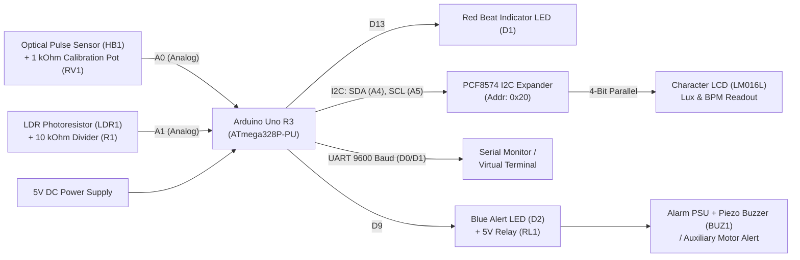
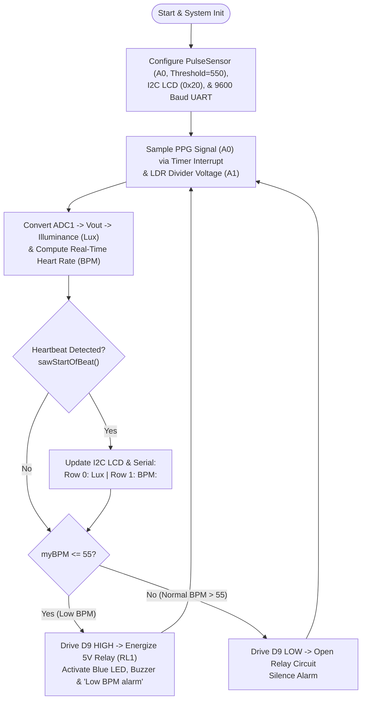

# Heart Rate & Ambient Light Monitoring System

An **Arduino Uno (ATmega328P)** physiological and environmental telemetry system combining interrupt-driven **photoplethysmography (PPG) heart rate sensing (`BPM`)** and **photoresistor illuminance measurement (`Lux`)** with **I2C LCD readout**, **UART serial logging**, and an automated **5V relay + piezo alarm stage** for bradycardia / drowsiness (`BPM <= 55`) detection.

## Key Features

- **Interrupt-Driven BPM Acquisition**: Uses `PulseSensorPlayground` with hardware timer interrupts (`USE_ARDUINO_INTERRUPTS true`) and configurable analog amplitude thresholding (`Threshold = 550`) on `A0` for beat-to-beat heart rate calculation and synchronized pulse LED feedback (`D13`).
- **Simultaneous Illuminance (`Lux`) Telemetry**: Samples a `10 kΩ` LDR voltage divider on `A1` and converts raw 10-bit ADC readings into standard illuminance units (`Lux`) alongside each detected heartbeat.
- **2-Wire I2C Display Expansion**: Drives an `LM016L` character LCD via a **`PCF8574` I2C I/O expander (`0x20`)** over `SDA` (`A4`) and `SCL` (`A5`), conserving MCU GPIO pins.
- **Automated Low-BPM Safety Alarm**: Triggers a **5V relay (`RL1`)**, visual fault LED (`D2`), piezo buzzer (`BUZ1`), and UART alert message whenever heart rate drops to or below **`55 BPM`** (e.g., patient bradycardia or operator drowsiness monitoring).
- **Proteus 8 Validated**: Complete mixed-mode schematic and virtual oscilloscope/terminal verification in **Proteus 8 Professional**.

## System Architecture

## Control & Alerting Flowchart

## Hardware Design & Pin Mapping

### Signal Conditioning & Conversion Equations
1. **Ambient Illuminance (`LDR1` + `R1 = 10 kΩ` on `A1`)**:
   - **ADC Voltage Conversion** (`10-bit ADC`, $V_{\text{ref}} = 5.0\text{ V}$):
     $$V_{\text{out}} = \text{ADC}_1 \times \frac{5.0}{1024} = \text{ADC}_1 \times 0.0048828125\text{ V}$$
   - **Resistance-to-Lux Conversion**:
     $$\text{Lux} = \frac{500}{10 \times \left(\frac{5 - V_{\text{out}}}{V_{\text{out}}}\right)}$$
2. **Optical Heart Rate (`HB1` on `A0`)**:
   - Analog PPG waveform conditioned with a `1 kΩ` calibration trimpot (`RV1`) and evaluated against `Threshold = 550` (`~2.69 V`) using hardware timer interrupts for low-jitter inter-beat interval timing.

### Arduino Uno (`ATmega328P`) & `PCF8574` Pinout

| Subsystem | Component | Arduino Pin | ATmega328P Port | Direction / Bus | Function |
| :--- | :--- | :--- | :--- | :--- | :--- |
| **PPG Input** | Heart Beat Sensor (`HB1`) | `A0` | `PC0 / ADC0` | `ANALOG IN` | Optical pulse waveform input (`Threshold = 550`) |
| **Light Sensor** | `TORCH_LDR` (`LDR1`) + `10 kΩ` (`R1`) | `A1` | `PC1 / ADC1` | `ANALOG IN` | Ambient light voltage-divider input (`Lux` conversion) |
| **I2C Display** | `PCF8574` (`U1`, `0x20`) -> `LM016L` | `A4`, `A5` | `PC4` (`SDA`), `PC5` (`SCL`) | `I2C` | `A0–A2 = GND` (`0x20`); `P0–P2` -> `RS,RW,E`; `P4–P7` -> `D4–D7` |
| **Alarm Stage** | `LED-BLUE` (`D2`) + `5V Relay` (`RL1`) | `D9` | `PB1 / OC1A` | `OUTPUT` | Energizes `RL1` & piezo buzzer (`BUZ1`) when `BPM <= 55` |
| **Beat LED** | `LED-RED` (`D1`) | `D13` | `PB5 / SCK` | `OUTPUT` | Synchronized visual blink on every detected pulse |
| **Telemetry** | UART Serial / Virtual Terminal | `D0`, `D1` | `PD0` (`RXD`), `PD1` (`TXD`) | `UART (9600)` | Streams `Lux`, `BPM`, and `"Low BPM alarm"` events |

## Repository Structure

- `firmware/Heart_Rate_Monitoring/Heart_Rate_Monitoring.ino` — Arduino sketch implementing interrupt-based BPM detection, LDR-to-Lux conversion, I2C LCD display updates, UART telemetry, and low-BPM alarm control.

## Dependencies & Simulation Setup

- **Arduino Libraries**:
  - `PulseSensorPlayground.h`
  - `Wire.h` (built-in I2C library)
  - `LiquidCrystal_I2C.h` (configured at slave address `0x20`)
- **Proteus 8 Simulation**:
  - Uses the Proteus **Heart Beat Sensor (`HB1`)** library model, `TORCH_LDR`, `PCF8574`, `LM016L`, Virtual Oscilloscope, and Virtual Terminal (`9600 8N1`).

## Academic Context

Developed in the **Department of Electronics and Communication Engineering**, Faculty of Engineering and Technology, **Ramaiah University of Applied Sciences (RUAS)**, Bengaluru. and relay-driven low-BPM alarm.
